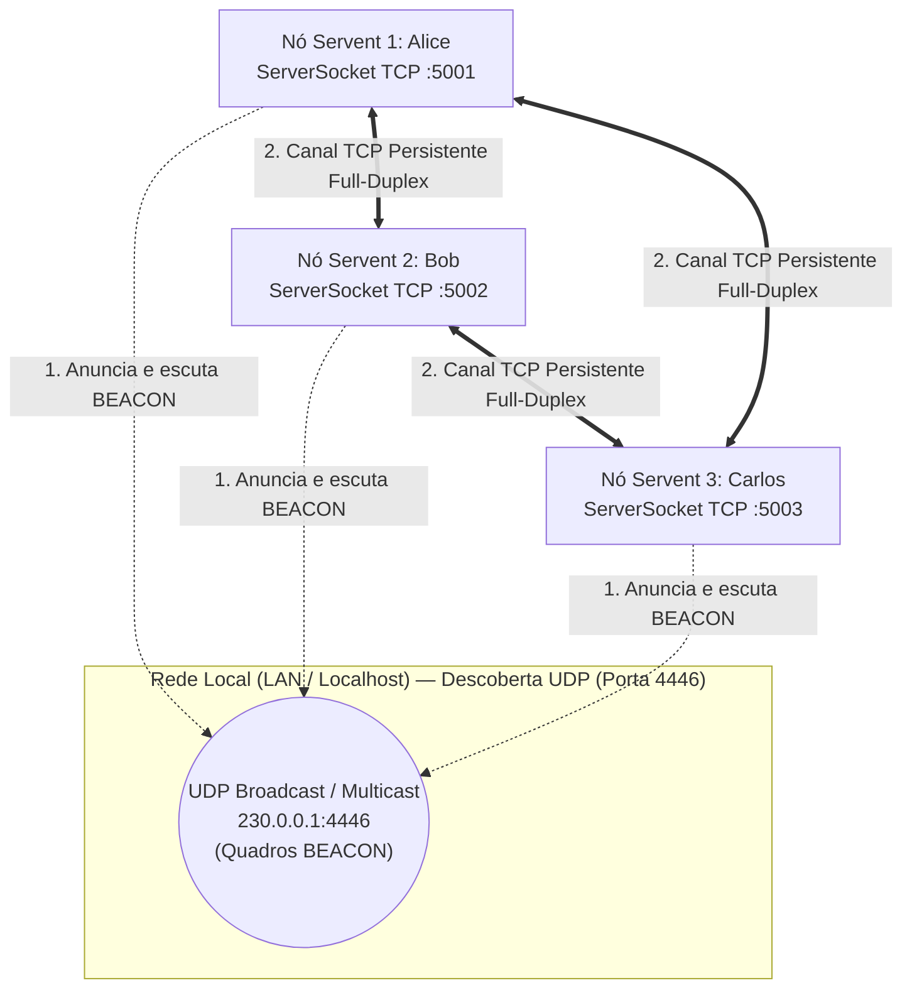

# 🌐 Sistema de Chat P2P Descentralizado — Protocolo `P2P/1.0`

Aplicação de mensagens instantâneas e compartilhamento de arquivos **100% Peer-to-Peer (P2P)** em rede local (LAN), desenvolvida em **Java 21 (Virtual Threads)** utilizando exclusivamente **Sockets nativos (`java.net.*`)**, sem servidor central.

Este documento foi preparado de forma **didática e passo a passo** para que qualquer integrante da equipe consiga compilar, demonstrar todas as funcionalidades ao vivo na **Prévia (25/Nov)** e na **Apresentação Final (07/Dez)**, e responder às perguntas técnicas da avaliação.

---

## 📌 Sumário

1. [Visão Geral e Conceitos de Redes Aplicados](#-1-visão-geral-e-conceitos-de-redes-aplicados)
2. [Pré-requisitos e Como Compilar](#-2-pré-requisitos-e-como-compilar)
3. [Roteiro Passo a Passo para a Apresentação (Guia Prático)](#-3-roteiro-passo-a-passo-para-a-apresentação-guia-prático)
4. [Tabela de Comandos do Chat (CLI)](#-4-tabela-de-comandos-do-chat-cli)
5. [Especificação do Protocolo de Aplicação `P2P/1.0`](#-5-especificação-do-protocolo-de-aplicação-p2p10)
6. [Arquitetura do Código — O Que Cada Arquivo Faz](#-6-arquitetura-do-código--o-que-cada-arquivo-faz)
7. [Perguntas Frequentes do Professor (Cola para a Apresentação)](#-7-perguntas-frequentes-do-professor-cola-para-a-apresentação)

---

## 🧠 1. Visão Geral e Conceitos de Redes Aplicados

Diferente de sistemas cliente-servidor tradicionais (onde todos se conectam a um servidor central e, se ele cair, a rede para), neste projeto **cada instância do programa é um *Servent* (*Server* + *Client*)**:

- **Papel de Servidor:** Abre uma porta de escuta TCP (`ServerSocket` a partir da porta `5001`) e uma porta UDP (`MulticastSocket` na porta `4446`) para receber conexões e anúncios de outros colegas.
- **Papel de Cliente:** Descobre automaticamente outros nós na rede e abre conexões ativas (`Socket` TCP) em direção a eles.
- **Uso Híbrido da Camada de Transporte:**
  - **UDP (Sem conexão, leve e rápido):** Usado para **Descoberta Automática de Vizinhos e Presença (`BEACON` e `BYE_UDP`)** via *Multicast* (`230.0.0.1:4446`) e *Broadcast* (`255.255.255.255:4446`). Assim, nenhum usuário precisa digitar o IP dos outros manualmente.
  - **TCP (Orientado a conexão, confiável e ordenado):** Usado para formar uma **Malha (Mesh) Full-Duplex Persistente** entre todos os nós descobertos. Por esses túneis TCP trafegam as mensagens em grupo (`MSG_ALL`), mensagens privadas (`MSG_PRIV`), transferências de arquivos (`FILE_SEND`) e controle de vivacidade (`PING`/`PONG`).



---

## 🛠️ 2. Pré-requisitos e Como Compilar

### Requisitos
- **Java 21+** (JDK 21 ou superior — utiliza *Virtual Threads / Project Loom*)
- **Apache Maven 3.8+**

Para verificar no terminal antes da apresentação:
```bash
java -version
mvn -version
```

### Compilando o Projeto
Na pasta raiz do projeto (`REDES-chat-p2p`), execute:
```bash
mvn clean compile
```

---

## 🎤 3. Roteiro Passo a Passo para a Apresentação (Guia Prático)

Você tem **duas formas** de demonstrar o projeto na apresentação:
1. **Demonstração Interativa em 3 Terminais (Principal):** Você abre 3 terminais lado a lado (representando `Alice`, `Bob` e `Carlos`) e digita ao vivo.
2. **Simulação Automatizada (`--demo`):** O próprio programa sobe os 3 nós sozinho, executa todos os testes da rubrica e mostra os logs detalhados no console.

---

### 🚀 Opção A: Demonstração Ao Vivo em 3 Terminais (Recomendado para o Professor)

Abra **3 terminais** na pasta do projeto (`REDES-chat-p2p`).

> **Dica:** Você pode rodar usando o Maven (`mvn -q exec:java -Dexec.args="Alice"`) **ou** diretamente com o comando `java` (que inicia instantaneamente após o `mvn compile`):

#### Passo 1: Iniciar os 3 Nós (Descoberta Automática e Malha TCP)

- **No Terminal 1 (Alice):**
  ```bash
  java -cp target/classes redes.p2p.Main Alice
  ```
  *(Alice assumirá automaticamente a porta TCP `5001`)*

- **No Terminal 2 (Bob):**
  ```bash
  java -cp target/classes redes.p2p.Main Bob
  ```
  *(Como a porta `5001` já está em uso pela Alice na mesma máquina, o programa detecta isso sozinho e aloca a porta `5002` para o Bob!)*

- **No Terminal 3 (Carlos):**
  ```bash
  java -cp target/classes redes.p2p.Main Carlos
  ```
  *(Carlos assumirá automaticamente a porta TCP `5003`)*

🗣️ **O que explicar para o professor neste momento:**
> *"Reparem que não passamos nenhum IP nem porta ao iniciar os 3 terminais. Assim que cada nó sobe, ele emite um datagrama UDP `BEACON` na rede local informando seu IP e sua porta TCP de escuta. Os outros nós capturam esse beacon UDP e abrem automaticamente uma conexão TCP persistente (handshake `HELLO` / `HELLO_ACK`), formando uma topologia em malha (mesh) completa."*

---

#### Passo 2: Mostrar a Tabela de Vizinhos e o Status Técnico

No terminal da **Alice** (ou de qualquer um), digite:
```text
/vizinhos
```
E em seguida:
```text
/status
```

🗣️ **O que explicar:**
> *"O comando `/vizinhos` exibe em tempo real a Tabela de Vizinhos mantida na memória de cada nó (`ConcurrentHashMap`), mostrando o ID único do nó, o apelido, o endpoint `<IP>:<PORTA_TCP>`, o estado do canal TCP (`CONECTADO`) e há quantos segundos o nó foi visto pela última vez."*

---

#### Passo 3: Ativar o Modo `/trace` (Para Mostrar a Gramática do Protocolo na Tela)

No terminal da **Alice**, digite:
```text
/trace
```

🗣️ **O que explicar:**
> *"Ativamos o modo `/trace` na Alice para inspecionar os quadros brutos da camada de aplicação (`P2P/1.0`) que entram (`RX`) e saem (`TX`) pelos sockets TCP e UDP."*

---

#### Passo 4: Enviar Mensagem em Grupo (`MSG_ALL`)

No terminal da **Alice**, basta digitar qualquer frase comum e apertar `Enter`:
```text
Ola pessoal, testando mensagem em grupo na malha P2P!
```

🗣️ **O que observar e explicar:**
- A mensagem aparece imediatamente nos terminais de **Bob** e **Carlos** com a tag `[GRUPO]`.
- No terminal da Alice (que está com `/trace` ligado), o professor verá o quadro exato enviado para cada conexão TCP:
  `P2P/1.0|MSG_ALL|N-XXXXXX|Alice|ALL|1763417000000|Ola pessoal...`

---

#### Passo 5: Enviar Mensagem Privada (`MSG_PRIV`)

No terminal da **Alice**, envie uma mensagem privada **apenas para o Carlos** usando `@Apelido`:
```text
@Carlos Esta mensagem e secreta so para voce!
```
*(Ou usando `/msg Carlos Esta mensagem e secreta so para voce!`)*

🗣️ **O que observar e explicar:**
- No terminal do **Carlos**, aparece em destaque roxo: `[PRIVADO de Alice]: Esta mensagem e secreta so para voce!`.
- No terminal do **Bob**, **não aparece nada**!
- **Explicação técnica importante:** *"A privacidade não é só um filtro visual na tela. Como cada par de nós tem um socket TCP dedicado, a Alice enviou o quadro `MSG_PRIV` exclusivamente pelo socket TCP que liga Alice a Carlos. Os bytes sequer passaram pela placa de rede/socket do Bob."*

---

#### Passo 6: Transferência de Arquivo (`FILE_SEND`)

No terminal do **Bob**, envie um arquivo (por exemplo, o próprio `pom.xml` do projeto) para a **Alice**:
```text
/file Alice pom.xml
```
*(Ou `/file ALL pom.xml` para enviar para todos os vizinhos de uma vez)*

🗣️ **O que observar e explicar:**
- No terminal da **Alice**, aparece o aviso:
  `[ARQUIVO RECEBIDO de Bob]: 'pom.xml' (1098 bytes) salvo em: .../downloads_p2p/Alice_5001/pom.xml`
- O arquivo é lido em bytes, codificado em Base64 junto com o nome e tamanho no payload do comando `FILE_SEND` e transmitido de forma confiável pelo canal TCP.

---

#### Passo 7: Simular Queda Abrupta / Tolerância a Falhas (Requisito Crítico!)

Agora vamos provar que a rede sobrevive quando um nó cai repentinamente sem avisar.

No terminal do **Carlos**, você pode apertar **`Ctrl + C`** (matando o processo na hora) ou digitar o comando especial de simulação de queda abrupta:
```text
/crash
```

Em seguida, no terminal da **Alice**, digite:
```text
/vizinhos
```
E mande uma nova mensagem para o Bob:
```text
Carlos caiu abruptamente, mas nossa rede entre Alice e Bob continua de pe!
```

🗣️ **O que observar e explicar:**
- No exato milissegundo em que o Carlos cai com `/crash` ou `Ctrl+C` (sem enviar mensagem `BYE`), os terminais de **Alice** e **Bob** exibem em vermelho:
  `[TOLERÂNCIA A FALHAS] Nó Carlos removido da tabela! Motivo: EOF (Conexão encerrada pelo par). Vizinhos restantes: 1`
- Ao digitar `/vizinhos` na Alice, o Carlos já foi **automaticamente expurgado** da tabela, restando apenas o Bob.
- A conversa entre Alice e Bob continua funcionando sem nenhum erro (`Broken pipe`) e sem travar a aplicação!

---

#### Passo 8: Encerramento Gracioso (`/sair`)

No terminal do **Bob**, digite:
```text
/sair
```
- Diferente do `/crash`, o `/sair` envia um quadro explícito `BYE` sobre o TCP e um `BYE_UDP` na LAN antes de fechar os sockets, avisando educadamente aos vizinhos que está saindo.

---

### ⚡ Opção B: Simulação Automatizada de 1 Comando (`--demo`)

Se quiserem mostrar um teste automatizado rápido que executa todas as 6 etapas acima sozinho (criando Alice, Bob e Carlos na memória, trocando mensagens em grupo, privadas, transferindo arquivo e derrubando o Carlos abruptamente):

```bash
java -cp target/classes redes.p2p.Main --demo
```
*(Ou `mvn -q exec:java -Dexec.args="--demo"`)*

---

### 🛡️ Plano de Contingência (E se o Wi-Fi da faculdade bloquear UDP Broadcast?)

Redes Wi-Fi corporativas ou universitárias às vezes ativam *Client Isolation* ou bloqueiam pacotes UDP Broadcast/Multicast entre notebooks diferentes:
1. **Se os 3 terminais estiverem no mesmo notebook:** Funciona **100% sempre**, pois o sistema operacional roteia pacotes loopback/multicast localmente sem passar pelo roteador Wi-Fi.
2. **Se estiverem em notebooks separados e o Wi-Fi filtrar UDP:** Basta usar o comando manual de conexão TCP direta em um dos terminais:
   ```text
   /connect <IP_DO_COLEGA>:<PORTA_TCP>
   ```
   Exemplo: `/connect 192.168.1.15:5001`. Isso abre o socket TCP diretamente e realiza o handshake `HELLO` / `HELLO_ACK` mesmo que o UDP esteja bloqueado na rede!

---

## 💻 4. Tabela de Comandos do Chat (CLI)

| Comando no Terminal | Descrição | Quadro Gerado na Rede |
| :--- | :--- | :--- |
| `<qualquer texto>` | Envia mensagem para **todos** os vizinhos conectados | `MSG_ALL` (via TCP) |
| `@<apelido> <texto>` | Envia mensagem **privada** direta para um vizinho específico | `MSG_PRIV` (via TCP) |
| `/msg <apelido> <texto>` | Alternativa ao `@<apelido>` para mensagem privada | `MSG_PRIV` (via TCP) |
| `/file <apelido\|ALL> <caminho>` | Envia um arquivo (até 5 MB) para um nó ou para `ALL` | `FILE_SEND` (via TCP) |
| `/vizinhos` (ou `/peers`) | Exibe a Tabela de Vizinhos completa e atualizada | *(Consulta local)* |
| `/status` (ou `/info`) | Exibe ID, Apelido, IP, Porta TCP, Porta UDP e nº de conexões | *(Consulta local)* |
| `/trace` (ou `/protocolo`) | Liga/desliga a exibição ao vivo dos quadros brutos `P2P/1.0` | *(Configuração local)* |
| `/nick <novo_apelido>` | Altera seu apelido em tempo real e anuncia na rede | `BEACON` imediato (UDP) |
| `/beacon` | Força o envio imediato de um anúncio de presença UDP | `BEACON` (via UDP) |
| `/connect <ip>:<porta>` | Conecta manualmente via TCP a outro nó | `HELLO` (via TCP) |
| `/crash` (ou `/queda`) | **Simula queda abrupta** (fecha sockets sem enviar `BYE`) | `TCP FIN/RST` |
| `/sair` (ou `/quit`) | Encerra o nó graciosamente avisando todos os vizinhos | `BYE` (TCP) + `BYE_UDP` (UDP) |
| `/ajuda` (ou `/help`) | Lista todos os comandos disponíveis na tela | *(Consulta local)* |

### Argumentos de Linha de Comando (Opcional na Inicialização)
```bash
java -cp target/classes redes.p2p.Main [Apelido] [--port <porta_tcp>] [--udp-port <porta_udp>] [--trace] [--demo]
```
- Exemplo iniciando com o modo `/trace` já ligado desde o primeiro segundo:
  ```bash
  java -cp target/classes redes.p2p.Main Alice --trace
  ```

---

## 📐 5. Especificação do Protocolo de Aplicação `P2P/1.0`

Todo pacote enviado na rede (seja dentro de um `DatagramPacket` UDP ou uma linha de texto UTF-8 em um `Socket` TCP) obedece rigorosamente à gramática abaixo.

### 5.1. Gramática Formal (EBNF Simplificada)

```ebnf
QUADRO      ::= VERSAO "|" COMANDO "|" ID_ORIGEM "|" NICK_ORIGEM "|" DESTINO "|" TIMESTAMP "|" PAYLOAD "\n"
VERSAO      ::= "P2P/1.0"
COMANDO     ::= "BEACON" | "BYE_UDP" | "HELLO" | "HELLO_ACK" | "MSG_ALL" | "MSG_PRIV" | "FILE_SEND" | "PING" | "PONG" | "BYE"
ID_ORIGEM   ::= TEXTO_ESCAPADO   (* Ex: N-8F3A1C *)
NICK_ORIGEM ::= TEXTO_ESCAPADO   (* Ex: Alice *)
DESTINO     ::= "ALL" | TEXTO_ESCAPADO
TIMESTAMP   ::= DIGITOS          (* Epoch em milissegundos *)
PAYLOAD     ::= TEXTO_ESCAPADO
```

### 5.2. Regras de Escape (Sanitização de Delimitadores)
E se o usuário digitar o caractere `|` ou uma quebra de linha no meio de uma mensagem do chat? Para que o parser nunca quebre ou confunda o texto do usuário com as divisórias do protocolo, a classe `ProtocolCodec` aplica escape automático antes de enviar e desfaz ao receber:
- `\` $\rightarrow$ `\\`
- `|` $\rightarrow$ `\p`
- `\n` $\rightarrow$ `\n` (literal)
- `\r` $\rightarrow$ `\r` (literal)

### 5.3. Todos os Comandos do Protocolo

| Comando | Transporte | Destino | Formato do Payload | Finalidade |
| :--- | :---: | :---: | :--- | :--- |
| `BEACON` | **UDP** | `ALL` | `<IP>:<PORTA_TCP>` | Anuncia presença na LAN a cada 2,5s para descoberta automática. |
| `BYE_UDP` | **UDP** | `ALL` | `<IP>:<PORTA_TCP>` | Avisa em broadcast/multicast que o nó está saindo voluntariamente. |
| `HELLO` | **TCP** | `ALL` | `<IP>:<PORTA_TCP>` | Handshake enviado logo após abrir conexão TCP com um vizinho. |
| `HELLO_ACK` | **TCP** | `<Nick>` | `<IP>:<PORTA_TCP>` | Resposta confirmando o handshake TCP e identificando o nó receptor. |
| `MSG_ALL` | **TCP** | `ALL` | `<Texto da mensagem>` | Mensagem pública enviada a todos os pares conectados na malha TCP. |
| `MSG_PRIV` | **TCP** | `<Nick>` | `<Texto da mensagem>` | Mensagem privada enviada somente na conexão TCP do destinatário. |
| `FILE_SEND` | **TCP** | `<Nick\|ALL>` | `<Nome>:<Bytes>:<Base64>` | Transfere um arquivo codificado em Base64 com nome e tamanho. |
| `PING` | **TCP** | `<Nick>` | `KEEPALIVE` | Enviado pelo *Watchdog* se o par ficar sem enviar beacons por >10s. |
| `PONG` | **TCP** | `<Nick>` | `OK` | Confirmação de que o nó continua vivo e responsivo. |
| `BYE` | **TCP** | `ALL` | `Desconectando` | Fecha a sessão TCP de forma limpa e remove o nó imediatamente. |

### 5.4. Exemplos Reais de Quadros na Rede

1. **Anúncio de descoberta via UDP (`BEACON`):**
   ```text
   P2P/1.0|BEACON|N-4A91B2|Alice|ALL|1763417100123|192.168.1.10:5001
   ```
2. **Handshake de abertura do canal TCP (`HELLO`):**
   ```text
   P2P/1.0|HELLO|N-4A91B2|Alice|ALL|1763417100450|192.168.1.10:5001
   ```
3. **Mensagem em Grupo via TCP (`MSG_ALL`):**
   ```text
   P2P/1.0|MSG_ALL|N-4A91B2|Alice|ALL|1763417115000|Boa noite pessoal!
   ```
4. **Mensagem Privada via TCP (`MSG_PRIV`):**
   ```text
   P2P/1.0|MSG_PRIV|N-4A91B2|Alice|Carlos|1763417120000|Segredo so para o Carlos
   ```

---

## 🧩 6. Arquitetura do Código — O Que Cada Arquivo Faz

O projeto está organizado em **4 pacotes claros** dentro de `src/main/java/redes/p2p/`. Abaixo está a explicação de cada classe para que todos saibam localizar qualquer funcionalidade durante a apresentação:

```text
src/main/java/redes/p2p/
├── Main.java                       # Ponto de entrada e simulação automatizada (--demo)
├── cli/
│   └── ConsoleUI.java              # Interface de terminal interativa, cores ANSI e comandos (/vizinhos, etc.)
├── model/
│   ├── MessageType.java            # Enum com os 10 tipos de comando (UDP e TCP)
│   ├── PeerInfo.java               # Representa um vizinho na Tabela de Vizinhos
│   └── ProtocolMessage.java        # Objeto imutável (record) que representa um quadro P2P/1.0
├── protocol/
│   └── ProtocolCodec.java          # Serializador e Parser (encode/decode, escape e Base64 de arquivos)
└── net/
    ├── NodeListener.java           # Interface de eventos (desacopla a rede da tela)
    ├── UdpDiscoveryService.java    # Emissor e receptor de Beacons UDP (Multicast + Broadcast)
    ├── PeerConnection.java         # Gerencia 1 socket TCP persistente com Virtual Thread dedicada
    └── P2PNode.java                # Coração do Servent (ServerSocket TCP, Tabela de Vizinhos e Roteamento)
```

### Detalhamento de Cada Classe

#### 1. `Main.java`
- Lê os parâmetros do terminal (apelido, porta, flags `--trace` e `--demo`).
- Se for modo normal, instancia a `ConsoleUI` e o `P2PNode`, inicia os serviços de rede (`node.start()`) e entra no loop de leitura do teclado.
- Contém o método `runAutomatedThreeNodeDemo()`, que instancia `Alice`, `Bob` e `Carlos` programaticamente para validar todos os requisitos em sequência.

#### 2. `model/MessageType.java`, `model/ProtocolMessage.java` e `model/PeerInfo.java`
- **`MessageType`**: Enumera os comandos do protocolo (`BEACON`, `HELLO`, `MSG_ALL`, `MSG_PRIV`, `FILE_SEND`, etc.) e documenta se pertencem ao transporte UDP ou TCP.
- **`ProtocolMessage`**: Um `record` do Java que guarda os 7 campos de toda mensagem (`version`, `type`, `senderId`, `senderNick`, `target`, `timestamp`, `payload`).
- **`PeerInfo`**: Guarda o estado de cada nó conhecido na Tabela de Vizinhos: `nodeId`, `nickname`, `ipAddress`, `tcpPort`, `lastSeenMillis` (último contato) e `tcpConnected` (se o túnel TCP já está estabelecido).

#### 3. `protocol/ProtocolCodec.java`
- Responsável por transformar um `ProtocolMessage` em texto/bytes (`encode` / `encodeBytes`) e transformar uma linha recebida da rede de volta em um `ProtocolMessage` (`decode`).
- Implementa `escape()` e `unescape()` para garantir que barras verticais (`|`) ou quebras de linha digitadas pelo usuário não corrompam o quadro.
- Implementa `encodeFilePayload()` e `decodeFilePayload()` para converter arquivos binários em texto Base64 seguro para transporte no quadro.

#### 4. `net/UdpDiscoveryService.java`
- Abre um `MulticastSocket` na porta `4446` com `SO_REUSEADDR` e `SO_BROADCAST` ativados (isso permite que vários terminais no mesmo computador escutem a mesma porta UDP `4446` simultaneamente!).
- Associa-se ao grupo Multicast `230.0.0.1` em todas as placas de rede ativas.
- Roda **duas Virtual Threads**:
  1. `udp-beacon-emitter`: A cada `2,5 segundos`, envia um datagrama `BEACON` para o grupo Multicast (`230.0.0.1`), para o Broadcast global (`255.255.255.255`), loopback broadcast (`127.255.255.255`) e para o endereço de broadcast de cada sub-rede local.
  2. `udp-discovery-listener`: Escuta continuamente datagramas UDP, ignora os pacotes enviados pelo próprio nó (comparando `senderId`) e repassa os beacons de outros nós para o `P2PNode`.

#### 5. `net/PeerConnection.java`
- Encapsula um `java.net.Socket` TCP aberto com um vizinho específico.
- Configura `TCP_NODELAY` (desativa o algoritmo de Nagle para baixa latência no chat) e `SO_KEEPALIVE`.
- Inicia uma **Virtual Thread (`Thread.ofVirtual()`)** exclusiva para ler linhas (`reader.readLine()`) daquele vizinho em loop contínuo.
- **Detecção instantânea de queda:** Quando o nó vizinho fecha o programa ou sofre um `Ctrl+C` / `/crash`, o sistema operacional envia um pacote `TCP FIN` ou `RST`. O método `reader.readLine()` retorna `null` (EOF) ou lança `IOException` **imediatamente**, acionando o callback `onDisconnect` no mesmo milissegundo!
- O método `send()` é `synchronized`, garantindo que duas threads não misturem bytes ao escrever no mesmo socket TCP simultaneamente.

#### 6. `net/P2PNode.java` (A Classe Mais Importante!)
É o núcleo do **Servent**. Ela mantém duas estruturas concorrentes (`ConcurrentHashMap`) thread-safe:
- `knownPeers`: A **Tabela de Vizinhos** (`nodeId -> PeerInfo`).
- `activeConnections`: Os **Canais TCP Ativos** (`nodeId -> PeerConnection`).

**Como o `P2PNode` evita conexões duplicadas quando dois nós se descobrem ao mesmo tempo?**
Quando `Alice` e `Bob` escutam o `BEACON` um do outro no mesmo instante, ambos poderiam tentar dar `new Socket()` um para o outro ao mesmo tempo, criando 2 conexões TCP redundantes entre o mesmo par. Para evitar isso, implementamos uma **regra determinística de desempate pelo `nodeId`** (linhas 349–366 e 468–487):
- O nó com o **menor `nodeId`** em ordem alfabética inicia a conexão TCP imediatamente.
- O nó com o **maior `nodeId`** aguarda `1,2 segundo` e só inicia a conexão se o outro ainda não tiver conectado. E mesmo que haja colisão, o método `registerOrUpdatePeerFromHandshake` mantém apenas uma conexão vencedora e fecha a duplicada de forma limpa.

#### 7. `cli/ConsoleUI.java`
- Implementa a interface `NodeListener` para imprimir na tela (com cores ANSI e sem bagunçar a linha que o usuário está digitando graças ao código de controle `\r\u001B[2K`) todos os eventos que vêm da rede.
- Interpreta os comandos digitados pelo usuário (`/vizinhos`, `@apelido`, `/file`, `/trace`, `/crash`, `/sair`).

---

## 🎓 7. Perguntas Frequentes do Professor (Cola para a Apresentação)

Aqui estão as perguntas clássicas de avaliação de Redes de Computadores e como qualquer membro do grupo pode responder com segurança:

### 1. *"Por que vocês usaram UDP e TCP juntos ao invés de só um deles?"*
> **Resposta:** "Porque cada protocolo de transporte tem características ideais para etapas diferentes do P2P:
> - Na **descoberta de vizinhos**, nós ainda não sabemos quem está na rede nem qual é o IP de cada um. O **UDP** permite enviar um único pacote sem conexão (*Broadcast/Multicast*) para toda a rede local com baixíssimo overhead.
> - Já para o **chat e envio de arquivos**, não podemos perder pacotes nem receber mensagens fora de ordem, além de precisarmos de privacidade ponto a ponto. Por isso, assim que dois nós se descobrem via UDP, eles abrem um canal **TCP** direto entre si, garantindo entrega confiável, controle de fluxo/congestionamento e detecção imediata de queda."

### 2. *"Como o programa garante que uma mensagem privada (`MSG_PRIV`) não seja lida pelos outros nós da rede?"*
> **Resposta:** "No nosso projeto, as mensagens de chat não são enviadas em broadcast UDP. Nós mantemos uma topologia em malha de conexões TCP individuais (`activeConnections`). Quando a Alice manda uma mensagem privada para o Carlos (`@Carlos`), o método `sendPrivateMessage()` na classe `P2PNode` busca na tabela apenas o socket TCP que liga Alice diretamente a Carlos e escreve o quadro `MSG_PRIV` exclusivamente nesse socket. O Bob sequer recebe esses pacotes na camada de transporte."

### 3. *"O que acontece quando um dos 3 terminais é fechado à força com `Ctrl+C` (queda abrupta)?"*
> **Resposta:** "Temos duas camadas de tolerância a falhas trabalhando juntas:
> 1. **Detecção imediata via TCP (Camada de Transporte):** Como cada vizinho tem uma *Virtual Thread* bloqueada em `reader.readLine()` no socket TCP (`PeerConnection.java`), assim que o processo do vizinho morre com `Ctrl+C`, o sistema operacional encerra o socket enviando um `TCP FIN/RST`. O `readLine()` detecta o `EOF` ou `IOException` instantaneamente e aciona o método `handleConnectionClosed()`, que remove o nó da Tabela de Vizinhos na mesma hora.
> 2. **Watchdog de Timeout e Heartbeat (`PING`/`PONG`):** Caso um cabo de rede seja puxado ou o Wi-Fi caia silenciosamente sem enviar `TCP FIN`, a thread `watchdogLoop()` em `P2PNode.java` verifica a cada `2,5s` se algum vizinho está há mais de `10 segundos` sem dar sinal de vida, enviando um comando `PING` sobre TCP e removendo o nó caso a transmissão falhe."

### 4. *"Como vocês trataram a concorrência para um nó conseguir conversar com vários pares ao mesmo tempo e ainda ler o teclado?"*
> **Resposta:** "Utilizamos **Virtual Threads do Java 21 (Project Loom)** junto com estruturas de dados concorrentes (`ConcurrentHashMap` para a Tabela de Vizinhos e conexões ativas, e `synchronized` na escrita de cada socket). Cada nó executa Virtual Threads independentes para:
> - Aceitar novas conexões no `ServerSocket` TCP;
> - Ler continuamente o fluxo TCP de cada vizinho conectado;
> - Emitir beacons UDP a cada 2,5s;
> - Escutar datagramas UDP na porta 4446;
> - Executar o *Watchdog* de tolerância a falhas;
> Enquanto a thread principal (`main`) fica dedicada a ler os comandos do usuário no terminal (`Scanner(System.in)`)."

### 5. *"Como vários terminais no mesmo computador conseguem usar o programa ao mesmo tempo sem dar erro de `Address already in use`?"*
> **Resposta:** "Tratamos isso tanto no UDP quanto no TCP:
> - No **UDP (`UdpDiscoveryService.java`)**, usamos `MulticastSocket` com `setReuseAddress(true)` (`SO_REUSEADDR`), permitindo que todos os processos na mesma máquina façam bind na porta UDP `4446` simultaneamente e recebam os mesmos pacotes Multicast/Broadcast.
> - No **TCP (`P2PNode.bindServerSocket`)**, o primeiro terminal faz bind na porta padrão `5001`. Quando o segundo terminal abre na mesma máquina e vê que a `5001` está ocupada, ele incrementa automaticamente e faz bind na `5002`, o terceiro na `5003`, e assim por diante, anunciando sua porta real dentro do payload do `BEACON` UDP (`<IP>:<PORTA_TCP>`)."
